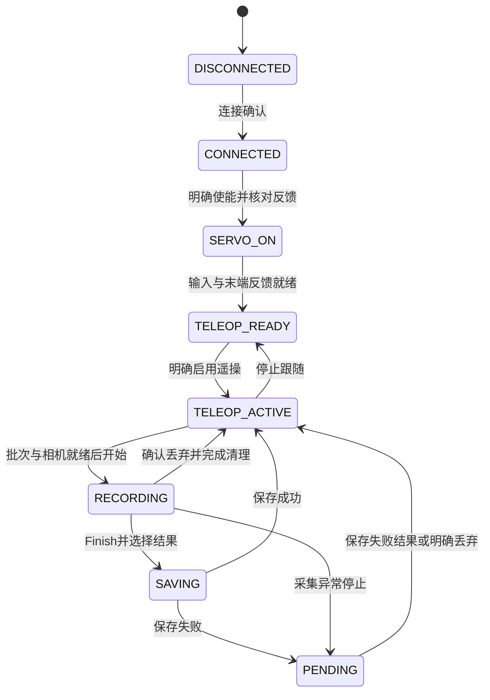
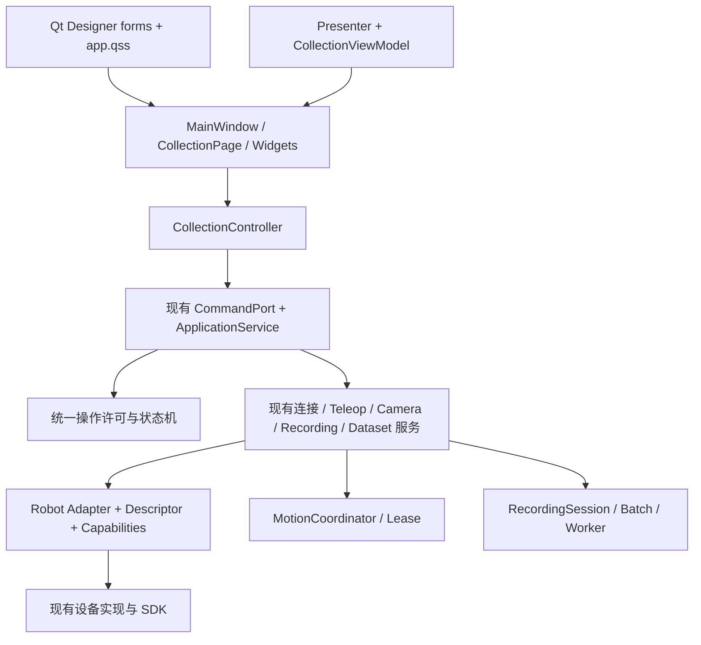

# 遥操作与数据采集 UI/UX 架构审计报告

日期：2026-10-17。阶段：P0，仅审计与方案。代码基准：`3aab1b978f9806d51afc3759be3e7fa7982eb6b0`，分支 `codex/workbench-structure-cleanup-20261017`。

## 审计结论与范围

建议保留现有应用命令入口、状态机、运动仲裁和采集后端，围绕它们逐步迁移 Qt Designer 布局、补充机器人能力描述、统一操作许可与状态呈现。当前没有按机器人复制页面，也没有 UI 直接调用设备 SDK 的问题；需要解决的是手写布局过多、状态来源与许可规则仍有分叉，以及几个能阻断正常操作的具体问题。

实施优先级遵循：操作正确性 → 机器人安全性 → 代码可维护性 → 交互逻辑 → 界面可读性 → 视觉美观。已确认的连接状态、HOME 前置条件和相机断流问题，应优先于配色、圆角等调整。

本次覆盖全部 19 个生产 UI Python 文件，以及它们连接到的 app/core/bootstrap、设备生命周期、运动仲裁、采集/批次/恢复/Writer 路径和相关功能测试。结合本会话已运行的六页离线界面观察布局；对关键问题进行无硬件内存复现。没有连接机器人、GELLO、O6 或相机，没有开展现场性能或物理停止验收，也没有重审厂商原生 SDK 的内部实现。

本阶段只新增本报告，不修改功能代码、配置、驱动、Policy 推理或模型训练代码。本文的“目标”“建议”均为后续 PR 设计，不表示已经实现。此前 834 项通过的记录属于上一轮验证，不作为本轮新增验证结果。

## 1. 当前 UI 文件与代码结构

正式入口为 `scripts/run_operator.sh → gello_cr.ui.__main__ → build_operator_application → create_operator_window`。启动保持 OFFLINE，相机停止，不自动连接或上使能。[入口][entry]

`src/gello_cr/ui` 共 19 个 Python 文件、3769 行。其中八个可视界面文件合计 2850 行：

- `main_window.py`：612 行，主壳、导航、状态显示、预览转换、设置装配和退出。
- `pages/collection.py`：769 行，设备准备、相机、Dataset、Episode 和已有 DAgger 高级区。
- `settings_dialog.py`：425 行，参数表、O6 动作表、相机发现与保存。
- `planning_panel.py`：345 行，关节/TCP/Waypoint 编辑、规划预览与执行。
- `trajectory_panel.py`：300 行，轨迹记录、库、导入与回放。
- `recovery_panel.py`：197 行，未完成批次与 Partial 决策。
- `pages/dataset_manager.py`：124 行，数据集扫描、详情与校验。
- `pages/robot_status.py`：78 行，设备反馈和复位入口。

其余文件承担 Presenter、ViewModel 适配、只读快照、命令端口、组合入口和快捷键等职责。对八个可视文件的 AST 统计为 183 处 Qt Widget 构造调用、63 处 Layout 构造调用；这是静态调用点，循环会创建更多实例，不是运行时控件数量。

目前受版本控制的项目资源中没有 `.ui`、`.qss` 或 `.qrc`。`pyproject.toml` 使用 `PySide6-Essentials>=6.7`，只有 Python 包发现配置，尚无 UI 资源打包规则。[依赖与打包][packaging]

## 2. 当前主要页面结构

左侧导航已有六页：数据采集、轨迹与回放、精确走点、数据集管理、机器人状态、设置。所有页面位于主窗口的 `QStackedWidget`，每页外包一层 `QScrollArea`。[主壳][shell]

顶部常驻 HOME、停止运动、软件紧急停止 F12；其下常驻机器人、运动、采集三个状态标签和一句操作提示。底部是错误/处理提示、未完成批次入口、可展开日志及一行英文综合状态。

采集页已有四步准备区：“连接机器人 → 准备主臂与手 → 使能机器人 → 开始遥操”。下方横向分隔为相机工作区和采集控制区；Dataset 设置在会话建立后自动折叠，录制按钮也会随 Recording/Pending 切换显示，DAgger 高级区默认折叠。这些已有设计应保留和完善。[准备区][preparation-ui] [录制呈现][episode-ui]

轨迹页与精确走点页主要使用密集的行式编辑器和文本预览；机器人状态页主要是诊断文本。设置页有机械臂、GELLO、O6、数采、规划、连接和相机画面标签页。它们的布局也需要迁入 Designer，但应与采集主流程分开提交。

## 3. 当前机器人选择与连接逻辑

当前只支持一个正式机器人 Profile：`cr3a_o6`。配置校验拒绝其他 Profile，工厂构造 CR3A 生命周期及 O6 设备；设置页的 Profile 为只读显示。[Profile 校验][profile] [工厂][factory]

`master.type=gello/roarm/inverse3` 选择的是遥操作输入设备，不是切换 CR3/CR5/Piper/UR 等机器人。采集页相机栏中禁用的 GELLO 下拉框也只是当前输入源的显示，不具有选择能力。[输入源显示][source-display]

“连接机器人”经命令端口在后台执行，创建会话并附到 Runtime，不自动使能。上使能是独立命令，并核对 NRC `servo_state==3` 后才确认成功。[连接生命周期][lifecycle]

已有 `RobotDevice` Protocol、RobotSnapshot、MasterDevice、CameraDevice、HandDevice 等契约，适合扩展；尚无统一的 RobotDescriptor/RobotCapabilities，也没有机器人注册与选择入口。[硬件契约][contracts]

建议先把当前 CR3A+O6 作为唯一可用配置项接入通用选择器，显示真实机器人身份与连接地址；后续按 Adapter/配置增加机器人，不提前添加未实现的 CR5/Piper/UR 驱动。只允许在设备断开、运动空闲、采集和待处理 Episode 已结束时切换 Profile。

## 4. 当前 GELLO 遥操作流程

实际主流程为：连接机器人 → “连接主臂 / O6” → 上使能 → 开始遥操。准备主臂和上使能在后端可以独立进行，现有界面优先引导准备设备。[准备命令][prepare-bindings]

GELLO 的串口/ID/标定来自配置，“连接主臂 / O6”同时准备输入设备和手部。Readiness 中区分主臂连接、O6 连接及各自错误；`devices_ready` 固定要求二者都连接。后端开始遥操也会检查它们，不只是禁用按钮。[Readiness][readiness] [后端前置条件][binding-readiness]

当前没有独立的“设备已发现”状态，也没有把 DISCOVERED、CONNECTED、反馈新鲜、TELEOP_READY 逐项展示。GELLO 已具备真实总线采样时间戳、反馈超时、跳变、速度和跟踪保护；不需要重写这些控制器。需要让 UI 明确展示其状态及未就绪原因。

“停止遥操”与全局“停止运动”有部分重叠，但语义不同：前者针对当前跟随，全局 STOP 要覆盖 HOME、回放、走点等控制源。建议保留一个始终可达的全局 STOP，并把局部按钮明确写成“启用遥操 / 停止跟随”；不再添加第三组含糊的 Start/Stop。

后续可以采用用户建议的顺序：选择机器人 → 连接并确认 → Servo On → 选择/连接遥操设备 → Teleop Ready → Enable Teleop。它应是清楚的引导顺序，不应在仅预览相机或检查设备时强制给机器人上使能。

## 5. 当前 Recording 流程

实际数据链已经是：`CR3O6CaptureSource → CaptureFrame → RecordingSession → BatchManager/SegmentWriter → WorkerDatasetWriter`，格式写入在独立 Worker 中完成。逐帧 journal、ACK、保存结果、异常保留和恢复已有实现，后续复用。[采集组合][capture-composition]

操作步骤为：选择格式/任务/父目录 → 创建批次，或直接点击开始 Episode 自动创建 → 采样 → “结束录制” → Pending → 成功保存、失败保存或丢弃 → 下一 Episode → 完成数据集并合并发布。

当前 START_EPISODE 的流程许可不只限于 TELEOP_RUNNING，也允许 ROBOT_ENABLED、REPLAY_RUNNING、POINT_MOVE_RUNNING 等状态；普通 Episode 排除 DAgger。界面再追加相机就绪条件。Joint 模式最终还需要真实活动控制源与已提交目标，不能用静止反馈代替动作。因此“按钮允许开始”与“真正可以取得有效首帧”目前不是同一条件。[状态许可][record-permission] [后端开始][start-recording]

“结束录制”只停止采样，尚未标注或完成保存，当前 UI 已用 Pending 提示这一点。零帧 Pending、写入失败保留、故障后只允许失败保存/丢弃等后端规则也已有实现；但 UI 对零帧、Recorder 错误的按钮许可仍不完整，存在点击保存后才被拒绝的情况。[保存约束][save-constraints]

建议主界面统一三个核心动作：Start Recording、Finish Episode、Discard Episode。Finish 按操作者明确选择的成功/失败结果停止采样并保存；结果未选时行内提示，不能悄悄把所有完成操作标为成功。保存失败保留 Pending 并明确可重试/可丢弃。底层 STOP_EPISODE/Pending 能力继续保留，用于故障和恢复，而不是删掉它来简化按钮。

Discard 应在 RECORDING 和 PENDING 均可提出，显示本段编号与帧数，确认一次后由后端停止采样并丢弃。普通操作不额外弹窗。全局停止运动仍不等于保存 Episode，界面必须持续提示这一区别。

Session 已提供配置/有效 FPS、迟帧数、最大帧间隔、相机重复帧和质量标记，Writer 还有写入延迟指标；可直接用于录制面板。当前没有真正的 Dropped Frames 计数，不能把迟帧或重复图像等同于丢帧，也不能拿配置 FPS 减实际 FPS 冒充准确计数。后续应在采样/写入拥有者处定义并统计实际跳过或丢失的样本，未统计前明确显示“未统计”。保存回执可复用 Session 的 `last_saved`，不必从日志反推保存成功。

## 6. 当前 Dataset 流程

采集页支持 LeRobot V2.1、LeRobot V3、HDF5，并提供父目录和任务信息。活动会话期间任务、描述、目录和格式已锁定；后端也拒绝活动会话切换格式。冻结范围比“仅录制时冻结”更强，适合一个批次保持一致 schema，不应放宽为每段随意改格式。[会话冻结][dataset-freeze] [格式后端校验][format-lock]

数据集管理页目前仅扫描、查看和校验已发布数据集。选中列表行不会把该数据集设成当前写入目标。“继续采集（新分段）”针对未完成批次：校验格式、Profile 和锁后创建新 Segment；不对已发布目录继续追加。[数据集管理][dataset-manager] [恢复入口][recovery-ui]

需要把“选择 Dataset”分清为三种用户意图：新建采集批次、继续未完成批次、查看已发布数据集。推荐将这三种入口集中呈现，保持已发布数据只读；不要为了满足选择控件而绕过现有安全发布流程。

还应明确三个位置：数据集父目录、采集中的 staging/Segment 目录、最终发布目录。Episode 保存成功的回执应指向本批次的已保存数据；只有完成合并和校验后，才显示“数据集已发布”和最终路径。

当前恢复要求操作者先选一致格式；建议选择未完成批次后读取其格式/任务并展示恢复前置条件，减少在两个页面之间记忆和来回切换。仍由既有 Recovery/BatchManager 执行配置兼容校验。

## 7. 当前相机管理逻辑

相机可独立于机器人启动。配置定义三个逻辑槽位，同一物理序列号可复用，支持完整 RGB 或 ROI；当前部署是三台相机，不应把第三路固定解释成 ROI。预览与录制使用相同来源。[相机桥接][camera-service]

已有后台发现、设备采集线程、桥接线程和 Frame Age/Skew 检查。每路 UI 已显示名称、Status、FPS、Age，开始采集前拒绝缺失或过期图像。显式停止相机会清空缓存，Recording/Pending 时界面和后端都阻止普通停止相机。

关键缺口发生在运行中断流：桥接遇设备错误只记错误并退出，采集缓存仍保留末帧；Source 对旧帧标记 age/skew 超限，Session 在录制循环继续写入。详见第 13 节。

建议拆出 CameraPanel/CameraViewWidget，自己负责名称、图像转换、缩放和状态覆盖层，MainWindow 不再直接访问三个 QLabel。断流时立即在旧图上覆盖“画面已过期/连接丢失”和时龄，不能让静止末帧看起来仍在实时更新。相机显示 FPS 与采集 FPS 分开，断流后的历史 FPS 不继续冒充当前帧率。

## 8. 当前状态管理方式

已有 `WorkflowStateMachine`、RobotState、MotionState、RecordingState，以及 `ApplicationService` 的串行普通命令、抢占代次与安全命令。MotionCoordinator/Lease 是实际运动权来源，RecordingSession 是 Episode 的来源，ViewModel 汇总这些状态给 UI。[状态机][machine] [ViewModel][view-model]

当前 Workflow 状态是 OFFLINE、CONNECTED、ROBOT_ENABLED、TELEOP_RUNNING、RETURNING_HOME、REPLAY_RUNNING、POINT_MOVE_RUNNING、DAGGER_RUNNING、FAULT、ESTOP；录制独立为 IDLE、RECORDING、PENDING、FINALIZING、RECOVERING。保留独立状态轴可以表达“回放同时录制”，应继续使用。

规则仍分散在 `state_machine.can()`、后端 handler 的前置校验、`build_application_view_model()`、页面 `render/_update_enabled()` 中。部分是合理的表单条件与防止重复提交，部分是业务许可重复：例如 Pending 禁止回放只在 ViewModel 上追加，而后端回放 handler 没有同等限制，详见第 13 节。

建议统一一个应用层操作许可计算，返回 `allowed + reason`，命令执行和 UI 都使用同一上下文。UI 只额外处理输入是否合法、选择项、请求处理中和面板展开等视图状态，不再补写安全许可。

用户要求的 DISCONNECTED → CONNECTED → SERVO_ON → TELEOP_READY → TELEOP_ACTIVE → RECORDING，可作为普通采集工作流的“当前步骤”投影。FAULT/ESTOP 优先覆盖；PENDING/SAVING 必须可见。这个投影不另行拥有设备状态，也不替换 MotionCoordinator 或 Recorder 的权威状态。

Servo 应有 ON/OFF/UNKNOWN 和反馈时龄，不能仅凭上一次命令成功推断一直 ON。GELLO 的已发现、已连接、反馈就绪也应分开；设备发现不代表控制已就绪。

普通采集目标许可应明确为：

- DISCONNECTED：允许连接，Servo/HOME/遥操/录制禁用；相机可独立准备。
- CONNECTED：允许明确 Servo On；未确认 ON 前不开放 HOME、遥操和录制。
- SERVO_ON / TELEOP_READY：按能力和新鲜反馈开放 HOME、连接设备或启用遥操；普通遥操采集仍不可开始。
- TELEOP_ACTIVE：当前批次/任务/相机就绪后允许开始录制；HOME 需先停止跟随。
- RECORDING / SAVING / PENDING：禁止机器人、Dataset、格式和遥操设备切换，禁止 HOME 和普通断开；保留该阶段可用的完成、失败保留、丢弃操作。
- FAULT / ESTOP：禁止启动运动与正常录制；有待处理数据时提供符合后端约束的失败保留/丢弃，再明确排故复位。不能用 HOME 绕过复位。

全局 STOP/F12 不受录制冻结限制。停止运动后，如采样所需的有效动作来源已经失效，应结束采样并保留待处理数据，不自动标为成功，也不自动恢复运动。

## 9. UI 与业务逻辑耦合点

已有边界值得保留：页面提交 Command 与 payload，由 MainWindow 统一封装 CommandRequest，页面渲染快照；未发现 UI 直接 import NRC/GELLO/O6/RealSense 实现，也未发现 `if robot_type == ...` 控制页面或下发动作的分支。轨迹预览显示 `robot_type` 文字不属于机器人分支。

仍需处理的耦合：

- MainWindow 一次刷新同时处理各页面 render、状态文案、Dataset 表单同步、设置锁定、恢复入口、错误和日志；相机转换/缩放也在该类。[刷新与预览][refresh]
- 采集页同时承担布局、命令 payload、步骤推断、录制指导、控件许可和 DAgger 外壳，769 行难以局部修改。
- 入口直接访问 `window.collection.task_edit/root_edit` 等控件并绑定保存目录持久化；后续由 CollectionController 接管 UI 初始化与表单意图。[表单装配][entry-form]
- Readiness 固定把 O6 当作必需；设置与部分文案写死 CR3/O6，规划与轨迹页写死六关节。数据 Source/schema 也有六关节加六手部通道的假设。新增不同末端或自由度的机器人，仅改 UI 能力开关还不够，需要 Adapter 提供通道/采集 schema 描述。[Readiness][readiness] [采集字段映射][capture-source]
- 通用 RobotDevice 契约尚未贯穿生产运动路径：工厂实际把 NRC session 接入 Runtime，MotionExecutor 仍调用 `send_servoj/movej/movel/open_servoj`，包含六轴和 SDK 单位假设；HOME、Servo 状态码、IK 也有 NRC 语义。多机器人适配必须从这一应用边界逐步隔离，不能仅添加 UI 下拉框。[运动执行器][executor]
- Presenter 自称只读，但其 RuntimeFaultSnapshotBridge 会把已安全停止的 Runtime 故障同步回应用状态。它不在 GUI 中直接操作设备；后续应让故障通知走应用层事件，减少“读快照会改变流程”的隐含行为。[故障桥][fault-bridge]

## 10. 当前可读性问题

可从本次离线运行画面和代码确认：

- 顶部只突出 Robot/Motion/Recording 三项；GELLO、O6、相机和 Fault 压在底部英文串中。Servo 反馈在机器人状态页，操作者不能在采集时快速区分“网络已连接”和“Servo 真正 ON”。
- 采集面板常驻指标仅已保存段数、帧数和秒数；Episode 编号、实际采集 FPS、保存路径在默认折叠详情里。没有真实 Dropped Frames 计数显示。[指标呈现][visible-metrics]
- 同一采集页两套提示分别描述设备准备与 Episode 前置条件，而两者对“是否必须先启动遥操”的表达不一致。
- 本会话 1440×940 的默认离线采集画面需要滚动才能看全下方相机与 Dataset 配置；嵌入设置页还有内外滚动。已录制/待保存时自动折叠设置已有专门可见性回归，不应泛化为“录制按钮始终不可见”。
- 关键状态和辅助说明目前混用 10–12px 字号；建议优先提高持续状态、录制数字、设备错误的层级。现场 DPI、远距离阅读和触摸使用尚未测量，不能据此声称已经实测不可读。

目标布局建议：固定全局状态与安全区；采集页上方紧凑步骤提示；中间相机与持续可见的录制控制；任务/Dataset 摘要常驻，编辑区在创建前展开、运行时冻结。错误显示在对应区域并保留全局摘要。使用间距、标题和少量分隔线，减少准备卡片和重复边框，不做玻璃拟态、渐变、阴影或动画。

当前不存在普遍的多层 GroupBox 套娃：主要是并列准备卡片、相机/采集两个 Frame，及设置中三个相机 GroupBox。应针对这些实际容器整理，不为消除 GroupBox 而重写所有页面。

## 11. 当前可维护性问题

第一，主要布局完全在 Python 中，不能用 Designer 调整结构。第二，MainWindow 和 CollectionPage 的显示、状态文案与操作逻辑未拆开。第三，机器人身份、能力、通道和固定 O6 要求没有独立描述接口。第四，快照仍大量依赖散落字符串键，多个页面各自理解状态和格式。可先为 Collection 增加小而明确的不可变视图模型，不必一次改造所有后端字典。

主题大部分已集中在 `theme.py`，但仍有六处 `setStyleSheet()`，位于主窗口、规划、轨迹和设置页。外置 QSS 时应覆盖这六处；正常加载应用主题的一处调用可以保留，禁止的是到处拼接/覆盖样式。[主题][theme] [局部错误样式][inline-style]

还存在迁 Designer 时必须处理的技术细节：

- 当前多个控件共用 `statusPill/mutedText/surfacePanel` 等 objectName 作为样式类。Designer 绑定需要稳定、唯一的控件名，应将样式语义转为 `role/state` 等动态属性。
- 当前页面构造需要 `submit`，Settings 需要 settings 对象，不能直接在 Designer Promote 后仅用 parent 构造。应先留普通 QWidget host，由 Python 显式注入依赖并装配；每个页面内部再 `setupUi(self)`。
- 现有部分测试检查 Python 源码中包含特定文案或 `setMinimumSize` 字符串。迁移时应将这些改为必要的可见行为/命令结果断言，不能让旧源码字符串测试阻止布局搬入 `.ui`。[旧布局测试][layout-tests]

## 12. 当前操作流程问题与目标流程

现状中的几个分叉需要明确：创建 Dataset 可以显式进行，也会在首段 Start 自动发生；普通录制可以在不同运动源下开始；结束采样与保存是两步；保存 Episode 和完成数据集是不同级别。已有提示覆盖一部分，但首次使用仍需要理解这些内部概念。

推荐普通遥操采集流程：

1. 在断开状态选择机器人 Profile，固定显示机器人名称、末端与连接目标。
2. 连接机器人，显示连接结果与 Servo 反馈；操作者明确 Servo On。
3. 选择并连接遥操设备，显示 GELLO/末端反馈是否新鲜；就绪后才启用遥操。
4. 选择新建批次或继续未完成批次，确认任务、格式、目录和相机画面。
5. Teleop Active 且采集前置条件齐全时，允许 Start Recording。
6. 固定显示 `● REC / 00:01:24 / Episode 023 / Frames / 采集 FPS / 质量异常`。
7. Finish 按明确结果保存，或者确认后 Discard；显示回执，再提示下一 Episode。
8. 完成数据集时单独显示合并/校验进度和最终发布结果。

建议采用此操作投影：



图中是普通采集的步骤投影；FAULT/ESTOP 可中断任何运行步骤，恢复后保持停止，由操作者重新开始。PENDING 处理完也不自动启动运动：只有原运动仍明确有效时才显示 TELEOP_ACTIVE，否则回到实际设备/运动状态。

回放/规划采集是已有能力。推荐普通遥操页面要求 Teleop Active；回放页或精确走点页明确选择“记录当前执行”后，按该实际运动源检查。由应用层操作上下文表达采集来源，不在一个按钮里暗中接受所有 `_ENABLED` 状态，也不修改已有 Policy 推理路径。

## 13. 安全风险、正确性问题与响应性

### 13.1 高优先级：正常下使能/断开污染 FAULT，断开后无法再次连接

`Cr3aLifecycle.power_off()` 借用 Runtime.emergency_stop，后者把 Runtime 设为 fault；`disconnect()` 调用 detach_robot，正常断开也留下 fault。应用命令完成后分别到 CONNECTED/OFFLINE，但下次 Presenter 轮询经故障桥又变成 FAULT。[生命周期停止][lifecycle-stop] [Runtime 断开][runtime-detach] [Runtime 急停][runtime-estop] [故障桥][fault-bridge]

无硬件复现使用真实生命周期、Runtime 方法和现有 Fake 设备，在完整项目虚拟环境中得到：

```text
POWER_OFF: command completed -> CONNECTED; runtime=fault
           next bridge poll -> FAULT; RESET_FAULT -> CONNECTED
DISCONNECT: command completed -> OFFLINE; runtime=fault
            next bridge poll -> FAULT; CONNECT not allowed
            RESET_FAULT -> CR3A 尚未连接
```

断开后 session 已清空，复位需要 session；因此常规 UI 没有可用重连路径。建议区分“受控停止/正常释放”和“异常断线/急停”，从状态拥有者修正，不能在 UI 隐藏错误或强行显示 OFFLINE。归入连接正确性前置修复/P3。

### 13.2 高优先级：CONNECTED 下 HOME 的许可与真实 NRC 前置条件冲突

状态机允许 CONNECTED 时 HOME，HomeService 也设计了自动 power_on；但它先调用 `wait_until_motion_stopped()`，真实 NrcRobotSession 在 servo_state 不等于 3 时立即抛错，后面的 power_on 到不了。[HOME 时序][home-order] [NRC 停止判断][nrc-wait]

使用真实 NrcRobotSession 和 Fake NRC API、Servo state=1 的内存复现：`HardwareError: CR5 等待停止过程中退出运行状态`，power_on API 未调用，Runtime 进入 fault。已有“连接后 HOME 自动使能”测试使用的高层 Fake 没有该 Servo 前置条件，未覆盖此差异。[现有 HOME 测试][home-test]

本次目标建议要求显式 Servo On 后再开放 HOME，从许可和后端前置条件一起收紧；不要靠更宽松的 Fake 或放宽驱动检查修复界面。

### 13.3 高优先级策略冲突：HOME 当前可越过录制及软件急停/故障锁

当前 RETURN_HOME 除 OFFLINE 和 RETURNING_HOME 外均允许，包括 FAULT、ESTOP 和正在录制；handler 不走 RESET_ESTOP 的确认路径。HomeService 会撤销其他运动、等待生产者退出，并尝试使能、回位；录制故意继续包含 HOME，回位后才停止采样。[HOME 许可][home-permission] [HOME handler][home-binding] [HOME 录制策略][home-order]

这有明确 Lease 抢占和停止确认，不是两个运动源同时无仲裁发送；但与本次要求的 REC 锁定 HOME、故障/急停明确排除再复位相冲突。建议默认禁止 RECORDING/PENDING/FAULT/ESTOP 中 HOME。普通遥操中也先明确停止跟随，再允许 HOME；不用一个隐式复合动作代替停止、复位、使能和回位。归入优先修复及 P4/P8。

### 13.4 高优先级数据风险：运行中相机断流仍记录重复/过期末帧

Camera bridge 异常退出不清旧图；Source 对过期仅打质量标记，Session 在循环中继续写。开始时严格校验和运行中异常策略不一致。[桥接退出][camera-error] [旧帧采样][capture-source] [逐帧写入][frame-write]

纯内存复现中，相机过期阈值 0.05 秒、停止更新 0.15 秒后，Episode 仍 active，写了 15 帧，每路重复 14 帧，`needs_review=True` 但 `error=""`。这证明当前行为，不代表真实现场断线时延的测量。

建议必要相机断线/持续过期时停止本段采样，保留 Pending，显式显示来源与最后有效帧；拒绝静默标成功，只提供符合保存能力的失败保留/丢弃。短时帧复用与彻底断流应有不同策略，不能见一次复用就停止。相机故障不自动等价于机器人急停；机器人是否停止按运动安全条件独立决定。归入 P5/P6/P8。

### 13.5 中优先级：UI 与后端许可不一致

Pending 时 ViewModel 禁止回放，但状态机仍允许、回放 handler 也不检查。无硬件直接命令复现中，UI actions=False、service.can=True，handler 仍进入回放。规划执行 handler 则已有 Pending 检查。[UI Pending 限制][pending-view] [回放 handler][replay-handler] [规划保护][plan-guard]

零帧 Pending 的保存、Recorder 错误后的成功保存也由 Session 最终拒绝，按钮仍可点。这些应由共享许可输出准确禁用原因，并在后台再次核对，不能仅靠页面额外 boolean。归入 P4/P6。

### 13.6 中优先级响应风险：后台 I/O 仍可能通过快照锁阻塞 GUI

设备命令、录制写盘、相机发现和退出主要已在后台，实际命令端口有 normal/safety/home 三个 Worker；没有必要全量改成 QThread。需要修正的是同步快照的依赖：

- GUI timer → Presenter.poll → Runtime.snapshot → MotionCoordinator.status；status 和 SDK send/open_servo 共用同一把锁。人为阻塞 Fake SDK send 的内存探针确认，poll 会等待其释放。[快照][runtime-snapshot] [仲裁锁][motion-lock] [SDK 锁区][motion-send]
- GUI → Recorder/Batch.snapshot 获取 Batch 锁；checkpoint/allocate 在该锁内执行 manifest save/fsync，慢盘可使 GUI 等待。这里只确认了代码等待链，未做现场耗时测量。[批次锁与快照][batch-snapshot] [锁内持久化][batch-io] [manifest 写盘][manifest-io]
- Source.preview_snapshot 在相机锁内复制三幅完整图，发生于每次 poll，即使 MainWindow 随后判断时间戳没变而不重绘；可以减少无变化图像复制。[预览快照][preview-copy]
- 设置保存和采集父目录持久化从 GUI 执行配置文件 I/O；可通过已有受管后台任务处理，完成后发 Qt Signal。[设置保存][settings-save] [保存目录绑定][entry-form]

建议发布快速读取的不可变状态缓存，把硬件 I/O 和持久化从 UI 所读锁的持有区移出，同时保留串行设备写入与 Lease 原子性。不能简单删除仲裁锁，也不能仅增大定时器间隔来掩盖问题。

### 13.7 已有保护与现场未决事项

Recording/Pending 时已禁止普通断开和下使能，活动会话不能改格式，停止相机也有后端检查。STOP/ESTOP 有独立通道、运动 Lease 会失效，旧完成通知不会覆盖新安全状态；这些都应保留。

F12 的应用事件过滤器覆盖本窗口所属对话框并忽略自动重复。Designer 迁移必须保持这一行为，不能退化为只有主按钮能急停。[急停快捷键][emergency]

目前没有用户提供的绝对关节/工作空间硬限位，仍保持可配置且不凭空填值。反馈新鲜度、物理急停、停止时间、到位与三路负载需要现场验收；本报告没有将软件状态或内存复现当作物理安全结论。

## 14. 推荐目标架构

在现有目录上增量增加，不大规模搬家：



通用 RobotDescriptor 至少描述 identity/display_name、关节名称/数量、末端类型、遥操兼容性和采集 schema 标识。RobotCapabilities 包含 supports_home、supports_gripper、supports_dual_arm、supports_joint_control、supports_cartesian_control、supports_freedrive。能力描述与当前可用性分开：支持 HOME 不代表已有有效 HOME 标定；支持 Cartesian 不代表当前 IK/运行条件已就绪。

沿用并扩充 `core/contracts.py` 的 RobotDevice 契约，CR3Adapter 先包装既有设备生命周期，不另造一套驱动。选择与构造放在 bootstrap/注册处；UI 只读 Descriptor/Capabilities，不出现 `robot_type` 分支。将生产运动路径中的厂商调用、轴数、状态码和单位转换逐步收进 Adapter 后，普通六轴机械臂可通过增加 Adapter、配置及必要通道映射复用 Collection；这是目标验收能力，当前尚未全部做到。不同自由度/双臂必须按 schema 能力明确支持范围，不能仅改名称就声称可采集。

主状态条持续显示机器人身份、连接、Servo、GELLO/当前输入源、Teleop、REC、采集 FPS、当前 Dataset/Episode 和 Fault。采用统一语义颜色：正常/就绪绿色，等待/警告橙色，故障/急停红色，断开/禁用灰色；同时用文字表达，不能仅靠颜色。

错误分层：普通完成信息用回执/Status Bar；质量警告行内显示；需要选择的风险动作才用 Dialog；机器人故障/急停用持续 Fault Banner。机器人、GELLO、相机、Servo、Recorder、Dataset 目录错误分别标来源，保留多个活动错误，避免当前一串 `or` 只显示第一条后遮住其他来源。

## 15. 推荐 `.ui` 文件拆分与 QSS 路径

推荐布局资源放在现有 `src/gello_cr/ui/forms/`，无需把 Python 主窗口强制搬到 app：

```text
src/gello_cr/ui/
  forms/
    main_window.ui
    pages/
      collection_page.ui
      trajectory_page.ui
      planning_page.ui
      dataset_manager_page.ui
      robot_status_page.ui
      settings_page.ui
    widgets/
      robot_status.ui
      teleop_control.ui
      camera_panel.ui
      camera_view.ui
      recorder_control.ui
      dataset_control.ui
      recovery_panel.ui
  generated/             pyside6-uic 产物，禁止手改
  widgets/               有独立行为的 Python Widget
  styles/app.qss         统一语义样式
```

`main_window.ui` 维护导航、安全区、固定状态、日志和页面 host；`collection_page.ui` 维护遥操/相机/录制/Dataset 的组合布局。CameraView、RobotStatus、TeleopControl、Recorder、Dataset 按独立行为和复用需要逐步提取为 Widget，不是 P1 必须一次全部拆完；不把每个标签再包一类。

推荐 `pyside6-uic` 生成 `Ui_*` 类，现有 Python 类调用 `setupUi(self)` 后接信号和 render。`.ui` 是人工维护来源，生成代码允许大量控件构造，但不可手改。另一种 QUiLoader 运行时加载也可用；本项目已有自定义构造、事件过滤器和较多测试属性接口，生成方式更容易保留接口，故优先采用前者。此为结合项目的方案判断，Qt 官方同时支持两条路径。[Qt 官方 Designer 文档](https://doc.qt.io/qtforpython-6/tutorials/basictutorial/uifiles.html)

提供一个明确的生成命令，普通开发与 CI 执行它；补充 forms/QSS 的包资源配置，资源定位不依赖当前工作目录。不要增加文件哈希匹配或生成文件逐行防御校验框架。

QSS 从 `theme.py` 外置到 `styles/app.qss`，在应用启动时统一加载；objectName 用唯一绑定名，状态/按钮级别用动态属性。Python 的主题 helper 仅保留设置属性、必要的 repolish 和加载，不拼接业务样式。

设置页以 Designer 管理外壳、标签和静态区；`SETTINGS_GROUPS` 描述的动态字段、动作表行和机器人关节数驱动的重复项可继续由 Python 生成。此类有数据依据的动态控件不应为了“零 Python 布局”复制两套参数定义。

## 16. 推荐 Controller / Manager 拆分

优先新增一个轻量 `ui/controllers/collection_controller.py`，接受现有 CommandPort 和 MainWindow 每次分发的 UiFrame：组织 CollectionViewModel、表单意图、步骤提示、命令许可理由、完成回执和风险确认。MainWindow 负责窗口生命周期、导航、全局安全入口和各页面装配；CollectionPage/Widget 负责绑定信号与显示。不要让 Controller 再创建机器人 Driver。

Presenter 保持一个轮询拥有者：沿用 MainWindow 的 QTimer，每次只调用一次 `poll()`，把同一份 UiFrame 分发给 Controller 和页面。`poll()` 会消费事件缓冲，禁止 Controller 与 MainWindow 各自轮询，造成保存回执/错误事件被其中一方提前取走。

具体迁移边界：

- MainWindow 的预览转换/缩放移入 CameraViewWidget/CameraPanel。
- Collection 的步骤和 Episode 文案从 QWidget 逻辑中提取为可读的视图模型；业务许可在 app 层统一。
- 入口的采集表单初始化/目录变更意图交给 Controller；持久化仍通过现有 Settings 服务。
- MainWindow 保留 closeEvent 与最终 GUI 更新，底层关闭顺序继续由 OperatorApplication.close 拥有。只有退出 UI 逻辑继续增长时再提取关闭协调器。

后端已有可承担目标 Manager 职责的服务：Cr3aLifecycle/RuntimeFactory 对应连接构造，TeleopService 对应遥操，CameraPollingService 对应相机，RecordingSession 对应采样，BatchManager/DatasetCatalog 对应批次与数据集。先通过已有服务增加通用 Adapter 描述和必要接口，不新增一层同名 RobotManager/TeleopManager/CameraManager/Recorder 把原调用机械转发。

保留规划页的 revision/plan_id 失效保护、格式冻结、受管 BackgroundJobs 与关闭重试；保留已有 Space 仅在相应 DAgger 状态启用及不自动重复的规则，不扩大其触发范围。后台任务完成通过 Qt Signal 回到 GUI；BackgroundJobs 的 callback 本身运行于 Worker，不能在其中直接改控件。Qt 的 GUI 对象留在主线程，耗时操作与结果通知分开。[Qt 官方线程说明](https://doc.qt.io/qtforpython-6.8/overviews/qtdoc-thread-basics.html)

## 17. 推荐 PR 路线与验收

P0 本报告完成后，建议先提交一个小范围连接/HOME 正确性修复 PR，处理 13.1/13.2 与急停 HOME 入口，不把这些改动藏在 Designer 布局迁移中。随后按以下阶段拆分；这里给出范围和验收，不在本阶段实施。

- **P1：Qt Designer 基础。** 先迁主壳、采集组合页和基础 Widget；保留命令、构造接口、快捷键、现有六页和退出行为。为 Designer 改唯一 objectName 时，同一 PR 同步调整相关 QSS 选择器/语义属性以保持样式，不等到 P2 才修复失效选择器。验收：主要结构可在 Designer 调整，Python 不再重复声明这些布局；生成文件禁止手改。其他页面在各自阶段逐步迁完。
- **P2：统一 QSS 与可读性。** 外置主题，移除局部覆盖，统一唯一控件名与状态属性；调整字体层级、间距和滚动。验收：状态颜色语义一致，最小窗口/常用屏幕与实际 DPI 下关键操作可见，无需截图像素或哈希比对。
- **P3：Robot Status 与连接。** 引入当前 CR3A Adapter 的 Descriptor/Capabilities、通用身份选择及 Servo 反馈；修复正常停止/断开状态污染，显示阶段与原因。验收：连接→使能→下使能→断开→再次连接完整可用；能力不足的控件正确隐藏/禁用；不自动使能。
- **P4：Teleop State Machine。** 将设备已连接/反馈就绪/遥操激活明确投影，共享 app 操作许可；收紧 HOME 与 FAULT/ESTOP/REC 的冲突。验收：Servo 未 ON 或输入未就绪不能启用遥操；同一规则同时约束按钮与命令执行；STOP/F12 始终保留安全入口。
- **P5：Camera Panel。** 提取相机 Widget，区分连接、帧新鲜、历史 FPS，遮盖失效末帧，补运行中断流策略；减少无变化复制和 UI 读锁等待。验收：三路来源与实际配置一致，断流直接可见；GUI 不同步等待设备 I/O。
- **P6：Recording State Machine。** 统一 Start/Finish/Discard、SAVING/PENDING/失败分支，录制期间冻结机器人/Dataset/格式/关键设备切换和 HOME；细化零帧与写入错误许可。验收：Finish 成功后才显示保存回执；失败保留数据与处理入口；Discard 有一次明确确认；不能静默假报成功。
- **P7：Dataset Interaction。** 集中呈现新建、继续未完成、只读浏览，常驻任务/Dataset/Episode 信息，区分 staging 与最终发布；迁移 Dataset/Recovery 布局。验收：当前写入批次不会因选中浏览列表变化；格式保持会话一致，恢复不要求用户猜测原格式。
- **P8：Error & Safety Feedback。** 统一各设备/Writer/目录错误、持续 Fault Banner 和原因提示，迁移机器人状态与设置静态布局；核对普通操作忙碌时全局停止仍可达，快照不被 SDK/磁盘锁阻塞。验收：设备异常不只出现在终端；故障后不自动继续运动/录制；多个错误可区分来源。
- **P9：Legacy UI Cleanup。** 完成轨迹/走点等剩余主要页面的纯布局迁移后，删除被替代的 `_build_*`、旧布局与重复许可代码，整理文档和源字符串测试。验收：仅一条正式启动/操作路径，所有主要页面布局由 `.ui` 维护，无未使用布局；新增普通机械臂不需要复制 Collection。

验证按阶段使用必要的功能场景：离线界面绑定、命令许可、连接往返、故障/急停、零帧/写盘失败、相机断流和保存回执。复用已有 Fake 与回归，不新增哈希匹配、像素匹配、额外冒烟框架或机械追求测试数量。只改布局时不重复跑所有格式 SDK 回归；改变录制/生命周期时运行对应已有回归，集成完成后再做完整离线回归。

本阶段没有实现任何上述 PR，也未创建新的机器人驱动、模型训练/部署页面或 Web 界面。现有 DAgger/Policy 仅作为需保持兼容的边界，不扩展或修改推理逻辑。

## 代码证据索引

以下位置均相对于本报告记录的 HEAD；后续重构后行号可能改变。

[entry]: /home/ubuntu/cyf/robot_learning_workbench/teleop/gello_CR/src/gello_cr/ui/__main__.py:60
[packaging]: /home/ubuntu/cyf/robot_learning_workbench/teleop/gello_CR/pyproject.toml:16
[shell]: /home/ubuntu/cyf/robot_learning_workbench/teleop/gello_CR/src/gello_cr/ui/main_window.py:66
[preparation-ui]: /home/ubuntu/cyf/robot_learning_workbench/teleop/gello_CR/src/gello_cr/ui/pages/collection.py:100
[episode-ui]: /home/ubuntu/cyf/robot_learning_workbench/teleop/gello_CR/src/gello_cr/ui/pages/collection.py:596
[profile]: /home/ubuntu/cyf/robot_learning_workbench/teleop/gello_CR/src/gello_cr/app/config_store.py:320
[factory]: /home/ubuntu/cyf/robot_learning_workbench/teleop/gello_CR/src/gello_cr/bootstrap/runtime_factory.py:334
[source-display]: /home/ubuntu/cyf/robot_learning_workbench/teleop/gello_CR/src/gello_cr/ui/pages/collection.py:199
[lifecycle]: /home/ubuntu/cyf/robot_learning_workbench/teleop/gello_CR/src/gello_cr/bootstrap/runtime_factory.py:138
[contracts]: /home/ubuntu/cyf/robot_learning_workbench/teleop/gello_CR/src/gello_cr/core/contracts.py:111
[prepare-bindings]: /home/ubuntu/cyf/robot_learning_workbench/teleop/gello_CR/src/gello_cr/bootstrap/preparation.py:75
[readiness]: /home/ubuntu/cyf/robot_learning_workbench/teleop/gello_CR/src/gello_cr/ui/readiness.py:10
[binding-readiness]: /home/ubuntu/cyf/robot_learning_workbench/teleop/gello_CR/src/gello_cr/app/runtime_bindings.py:175
[capture-composition]: /home/ubuntu/cyf/robot_learning_workbench/teleop/gello_CR/src/gello_cr/bootstrap/runtime_factory.py:394
[record-permission]: /home/ubuntu/cyf/robot_learning_workbench/teleop/gello_CR/src/gello_cr/core/state_machine.py:183
[start-recording]: /home/ubuntu/cyf/robot_learning_workbench/teleop/gello_CR/src/gello_cr/app/runtime_bindings.py:207
[save-constraints]: /home/ubuntu/cyf/robot_learning_workbench/teleop/gello_CR/src/gello_cr/recording/session.py:230
[dataset-freeze]: /home/ubuntu/cyf/robot_learning_workbench/teleop/gello_CR/src/gello_cr/ui/pages/collection.py:712
[format-lock]: /home/ubuntu/cyf/robot_learning_workbench/teleop/gello_CR/src/gello_cr/app/runtime_bindings.py:228
[dataset-manager]: /home/ubuntu/cyf/robot_learning_workbench/teleop/gello_CR/src/gello_cr/ui/pages/dataset_manager.py:56
[recovery-ui]: /home/ubuntu/cyf/robot_learning_workbench/teleop/gello_CR/src/gello_cr/ui/recovery_panel.py:31
[camera-service]: /home/ubuntu/cyf/robot_learning_workbench/teleop/gello_CR/src/gello_cr/bootstrap/camera_service.py:63
[machine]: /home/ubuntu/cyf/robot_learning_workbench/teleop/gello_CR/src/gello_cr/core/state_machine.py:157
[view-model]: /home/ubuntu/cyf/robot_learning_workbench/teleop/gello_CR/src/gello_cr/app/view_model.py:111
[refresh]: /home/ubuntu/cyf/robot_learning_workbench/teleop/gello_CR/src/gello_cr/ui/main_window.py:304
[entry-form]: /home/ubuntu/cyf/robot_learning_workbench/teleop/gello_CR/src/gello_cr/ui/__main__.py:103
[capture-source]: /home/ubuntu/cyf/robot_learning_workbench/teleop/gello_CR/src/gello_cr/recording/source.py:140
[executor]: /home/ubuntu/cyf/robot_learning_workbench/teleop/gello_CR/src/gello_cr/motion/executor.py:22
[fault-bridge]: /home/ubuntu/cyf/robot_learning_workbench/teleop/gello_CR/src/gello_cr/ui/backend.py:41
[visible-metrics]: /home/ubuntu/cyf/robot_learning_workbench/teleop/gello_CR/src/gello_cr/ui/pages/collection.py:734
[theme]: /home/ubuntu/cyf/robot_learning_workbench/teleop/gello_CR/src/gello_cr/ui/theme.py:3
[inline-style]: /home/ubuntu/cyf/robot_learning_workbench/teleop/gello_CR/src/gello_cr/ui/main_window.py:453
[layout-tests]: /home/ubuntu/cyf/robot_learning_workbench/teleop/gello_CR/tests/v2/test_phase6_7_ui_layout_boundary.py:11
[lifecycle-stop]: /home/ubuntu/cyf/robot_learning_workbench/teleop/gello_CR/src/gello_cr/bootstrap/runtime_factory.py:179
[runtime-detach]: /home/ubuntu/cyf/robot_learning_workbench/teleop/gello_CR/src/gello_cr/app/runtime.py:229
[runtime-estop]: /home/ubuntu/cyf/robot_learning_workbench/teleop/gello_CR/src/gello_cr/app/runtime.py:599
[home-order]: /home/ubuntu/cyf/robot_learning_workbench/teleop/gello_CR/src/gello_cr/app/home_service.py:114
[nrc-wait]: /home/ubuntu/cyf/robot_learning_workbench/teleop/gello_CR/src/gello_cr/devices/nrc_robot.py:449
[home-test]: /home/ubuntu/cyf/robot_learning_workbench/teleop/gello_CR/tests/test_runtime.py:985
[home-permission]: /home/ubuntu/cyf/robot_learning_workbench/teleop/gello_CR/src/gello_cr/core/state_machine.py:227
[home-binding]: /home/ubuntu/cyf/robot_learning_workbench/teleop/gello_CR/src/gello_cr/app/runtime_bindings.py:283
[camera-error]: /home/ubuntu/cyf/robot_learning_workbench/teleop/gello_CR/src/gello_cr/bootstrap/camera_service.py:121
[frame-write]: /home/ubuntu/cyf/robot_learning_workbench/teleop/gello_CR/src/gello_cr/recording/session.py:199
[pending-view]: /home/ubuntu/cyf/robot_learning_workbench/teleop/gello_CR/src/gello_cr/app/view_model.py:175
[replay-handler]: /home/ubuntu/cyf/robot_learning_workbench/teleop/gello_CR/src/gello_cr/app/runtime_bindings.py:305
[plan-guard]: /home/ubuntu/cyf/robot_learning_workbench/teleop/gello_CR/src/gello_cr/app/runtime_bindings.py:346
[runtime-snapshot]: /home/ubuntu/cyf/robot_learning_workbench/teleop/gello_CR/src/gello_cr/app/runtime.py:644
[motion-lock]: /home/ubuntu/cyf/robot_learning_workbench/teleop/gello_CR/src/gello_cr/motion/coordinator.py:132
[motion-send]: /home/ubuntu/cyf/robot_learning_workbench/teleop/gello_CR/src/gello_cr/motion/coordinator.py:267
[batch-snapshot]: /home/ubuntu/cyf/robot_learning_workbench/teleop/gello_CR/src/gello_cr/recording/batch.py:355
[batch-io]: /home/ubuntu/cyf/robot_learning_workbench/teleop/gello_CR/src/gello_cr/recording/batch.py:190
[manifest-io]: /home/ubuntu/cyf/robot_learning_workbench/teleop/gello_CR/src/gello_cr/recording/manifest.py:24
[preview-copy]: /home/ubuntu/cyf/robot_learning_workbench/teleop/gello_CR/src/gello_cr/recording/source.py:82
[settings-save]: /home/ubuntu/cyf/robot_learning_workbench/teleop/gello_CR/src/gello_cr/ui/settings_dialog.py:388
[emergency]: /home/ubuntu/cyf/robot_learning_workbench/teleop/gello_CR/src/gello_cr/ui/emergency_shortcut.py:23
